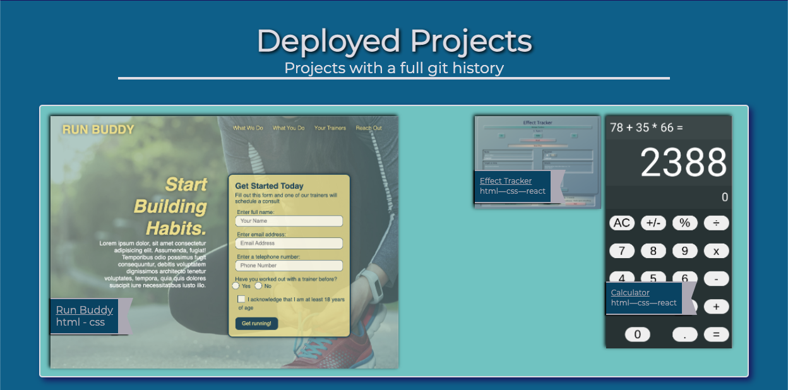

# Daniel Denton's Portfolio

Deployed page: [Daniel Denton's portfolio website](http://highdynamics.github.io)

## About Me

I started coding in 2019 and have taken great joy in putting pieces together and seeing them work. I'm currently enrolled in a coding bootcamp with Kansas University where I am learning to leverage the MERN stack.

Thanks for taking the time to take a look at my work!

This website was built with a mobile-first design in React.

## Scripts

Built with [Vite](https://vite.dev).

- `npm start` (or `npm run dev`): runs the site in development at [http://localhost:5173/](http://localhost:5173/).
- `npm test`: runs the tests once with [Vitest](https://vitest.dev).
- `npm run build`: builds the site into `dist`.
- `npm run preview`: serves the built site.
- `npm run deploy`: builds the site and publishes `dist` to the `gh-pages` branch.
